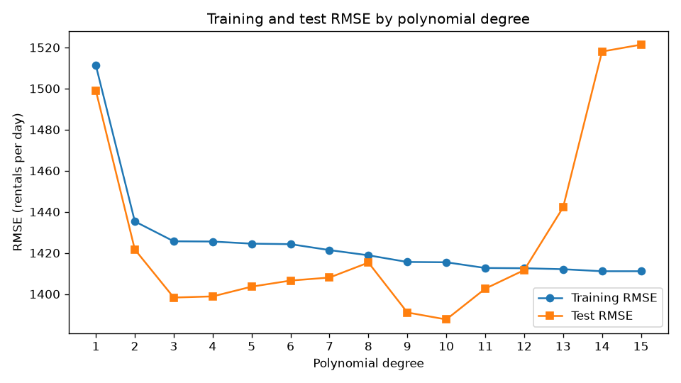

# نتایج رگرسیون چندجمله‌ای برای پیش‌بینی اجارهٔ روزانهٔ دوچرخه

درجهٔ **۱۰** در میان مدل‌های بررسی‌شده کمترین خطای آزمون را داشت. مقدار این خطا **۱٬۳۸۷٫۶۱ اجاره در روز** بود.

## روش آزمایش

مدل تعداد کل اجاره‌های روزانه (`cnt`) را فقط از روی دمای نرمال‌شده (`temp`) پیش‌بینی می‌کند. پس از درهم‌ریزی داده‌ها با بذر تصادفی ۴۲، از ۷۳۱ روز موجود، ۵۸۴ روز برای آموزش و ۱۴۷ روز برای آزمون در نظر گرفته شد. همهٔ مدل‌ها با روش کمترین مربعات و روی همان داده‌های آموزشی برازش شدند.

معیار ارزیابی، ریشهٔ میانگین مربعات خطا (RMSE) است. این معیار از اختلاف بین تعداد واقعی اجاره‌ها و پیش‌بینی مدل به‌دست می‌آید و واحد آن «اجاره در روز» است. مقدار کمتر نشان‌دهندهٔ خطای کمتر است.

## خطای آموزش و آزمون

| درجهٔ چندجمله‌ای | خطای آموزش | خطای آزمون |
| ---: | ---: | ---: |
| ۱ | ۱٬۵۱۱٫۲۴ | ۱٬۴۹۹٫۰۱ |
| ۲ | ۱٬۴۳۵٫۳۴ | ۱٬۴۲۱٫۶۷ |
| ۳ | ۱٬۴۲۵٫۶۶ | ۱٬۳۹۸٫۲۷ |
| ۴ | ۱٬۴۲۵٫۵۵ | ۱٬۳۹۸٫۸۴ |
| ۵ | ۱٬۴۲۴٫۵۱ | ۱٬۴۰۳٫۵۸ |
| ۶ | ۱٬۴۲۴٫۲۶ | ۱٬۴۰۶٫۵۴ |
| ۷ | ۱٬۴۲۱٫۳۸ | ۱٬۴۰۸٫۰۱ |
| ۸ | ۱٬۴۱۸٫۸۴ | ۱٬۴۱۵٫۳۰ |
| ۹ | ۱٬۴۱۵٫۵۹ | ۱٬۳۹۱٫۰۱ |
| **۱۰** | **۱٬۴۱۵٫۴۵** | **۱٬۳۸۷٫۶۱** |
| ۱۱ | ۱٬۴۱۲٫۶۷ | ۱٬۴۰۲٫۵۹ |
| ۱۲ | ۱٬۴۱۲٫۵۴ | ۱٬۴۱۱٫۶۳ |
| ۱۳ | ۱٬۴۱۲٫۰۷ | ۱٬۴۴۲٫۱۶ |
| ۱۴ | ۱٬۴۱۱٫۰۸ | ۱٬۵۱۸٫۰۳ |
| ۱۵ | ۱٬۴۱۱٫۰۸ | ۱٬۵۲۱٫۳۷ |

## نمودار تغییر خطا

خط آبی خطای آموزش و خط نارنجی خطای آزمون را نشان می‌دهد. محور افقی درجهٔ چندجمله‌ای و محور عمودی مقدار خطا بر حسب اجاره در روز است.

## تفسیر نتایج

- **درجه‌های پایین.** از درجهٔ ۱ تا ۳، خطای آموزش و آزمون هر دو کاهش یافتند. این بهبود نشان می‌دهد که مدل درجهٔ ۱، که فقط یک خط راست برازش می‌کند، احتمالاً رابطهٔ دما و تعداد اجاره‌ها را بیش از حد ساده کرده است. این الگو با کم‌برازش سازگار است.
- **درجه‌های بالا.** پس از درجهٔ ۱۰، خطای آموزش اندکی کاهش یافت، اما خطای آزمون در هر مرحله بیشتر شد و در درجهٔ ۱۵ به ۱٬۵۲۱٫۳۷ رسید. این الگو نشانهٔ بیش‌برازش در درجه‌های بالاتر روی همین تقسیم داده‌هاست.
- **محدودیت مدل.** برای دو روز با دمای یکسان، مدل تعداد یکسانی را پیش‌بینی می‌کند. تفاوت‌هایی مانند بارندگی یا تعطیل بودن روز می‌توانند تقاضا را تغییر دهند و در پیش‌بینی این مدل لحاظ نمی‌شوند.

طبق صورت تمرین، داده‌های آزمون برای مقایسهٔ درجه‌ها استفاده شدند. بنابراین خطای گزارش‌شده برای درجهٔ ۱۰ حاصل انتخاب و ارزیابی مدل روی همین مجموعهٔ آزمون است.

[جدول و نمودار اصلی در دفترچهٔ ژوپیتر](linear_regression.ipynb)
